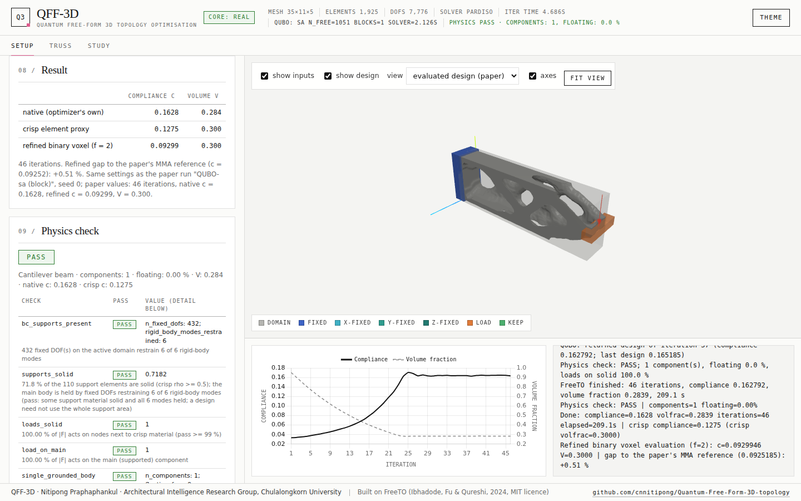

# QFF-3D: Quantum Free-Form 3D Topology Optimization

[](https://github.com/cnnitipong/QUBO-FreeTO/actions/workflows/ci.yml)
[](LICENSE)
[](requirements.txt)

QFF-3D optimizes the topology of freeform 3D parts given as STL files (design domain, fixed regions, load
regions). Its design update is a **quadratic unconstrained binary optimization (QUBO)** problem, one binary
variable per voxel, split into independent blocks of up to 64 variables that a quantum annealer, the quantum
approximate optimization algorithm (QAOA) or a classical binary solver can solve. The finite element and
smooth-boundary core is a Python port of FreeTO (Ibhadode, Fu & Qureshi, 2024, MIT licence). A browser app
runs the examples or your own STLs, shows the design in 3D and exports the optimized STL. The default
settings reproduce the examples of the accompanying manuscript exactly.



## Author

**Nitipong Praphaphankul**, Center of Excellence in Urban Strategies and Healthy Cities, Faculty of
Architecture, Chulalongkorn University, Bangkok, Thailand (<nitipong.pr@chula.ac.th>).

The QUBO design update (binary local model with Gauss-Newton couplings on Morton-ordered patches, multiplier
volume control, connectivity repair, quantum-solver interfaces, benchmark against MMA) and the QFF-3D software
were developed by Nitipong Praphaphankul.

## Quick start

Python 3.10 to 3.13. The launchers create their own virtual environment on the first run and open the app:

- Windows: double-click `Start QFF-3D (Windows).bat`
- macOS: double-click `Start QFF-3D (macOS).command`
- Linux: `./run_app.sh`

Or with pip:

```bash
git clone https://github.com/cnnitipong/QUBO-FreeTO.git
cd QUBO-FreeTO
python -m venv .venv && . .venv/bin/activate      # Windows: .venv\Scripts\activate
pip install -r requirements.txt
python -m webapp.server --port 8000 --open        # web app at http://127.0.0.1:8000/
```

Docker: `docker build -t qff3d . && docker run --rm -p 7860:7860 -e QFF3D_PUBLIC=0 qff3d`
(app at http://localhost:7860/).

Optional quantum backends (D-Wave Ocean, Qiskit): `pip install -r requirements-quantum.txt`, then set
`DWAVE_API_TOKEN` or `QISKIT_IBM_TOKEN`. The simulated backends (`sa`, `sqa`, `exact`, `tabu`, `greedy`,
`qaoa`) need no extra package.

## Command line and Python

```bash
python -m freeto.cli --list-examples
python -m freeto.cli --example GE_bracket --mesh 40 --out ge.stl                  # FreeTO (SIMP, OC)
python -m freeto.cli --example GE_bracket --mesh 40 --optimizer QUBO --out ge.stl # QUBO design update
```

```python
from freeto import run_freeto, example_config

cfg = example_config("air_bracket", mesh_control=50)
res = run_freeto(cfg, log=print)
print(res.comp, res.finalvol, res.iterations)
res.write_stl("air_bracket.stl")
```

## Reproducing the paper

The web app and the command line default to the paper's settings. [`docs/PAPER_SETTINGS.md`](docs/PAPER_SETTINGS.md)
lists every setting and how to reproduce the tables and figures (`python -m freeto.study`, `freeto/paper.py`,
`scripts/export_paper_reference.py`). Keep one thread per process (`OMP_NUM_THREADS=1`, the default), since
results depend on the floating-point summation order. Design notes: [`docs/`](docs).

## Tests

```bash
pip install -r requirements.txt pytest httpx
OMP_NUM_THREADS=1 python -m pytest -q
```

The browser tests skip themselves when Playwright is not installed.

## Citation

Please cite the software ([`CITATION.cff`](CITATION.cff)) and the manuscript (submitted, not yet published):

> N. Praphaphankul, C. Khosakitchalert, "Freeform 3D topology optimization with quantum-annealing-ready
> binary design updates", submitted to *Engineering Structures* (2026).

and FreeTO: O. Ibhadode, Y.-F. Fu, A. Qureshi, "FreeTO - Freeform 3D topology optimization using a structured
mesh with smooth boundaries in Matlab", *Advances in Engineering Software* 198 (2024) 103790,
doi:[10.1016/j.advengsoft.2024.103790](https://doi.org/10.1016/j.advengsoft.2024.103790).

## Licence

MIT ([`LICENSE`](LICENSE)). Third-party code (FreeTO, `intriangulation`, three.js, Chart.js) keeps its own
licence: [`THIRD_PARTY_NOTICES.md`](THIRD_PARTY_NOTICES.md). Contributions: [`CONTRIBUTING.md`](CONTRIBUTING.md).
